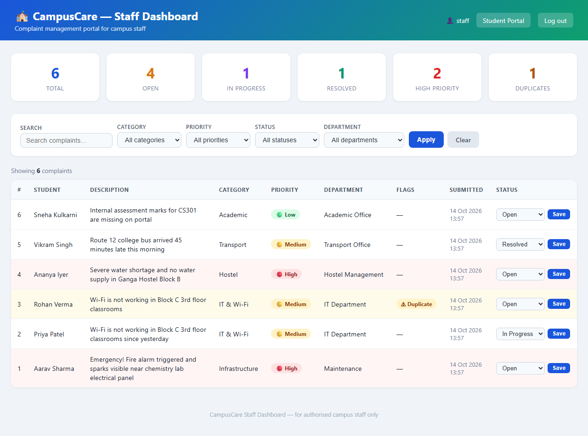
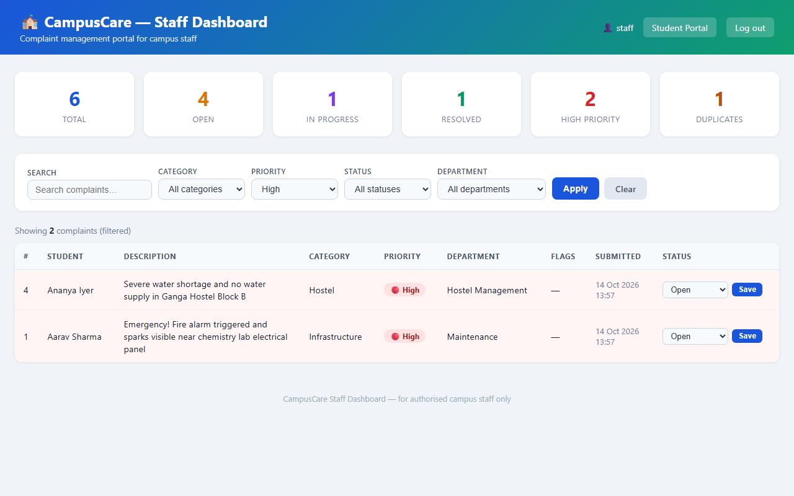
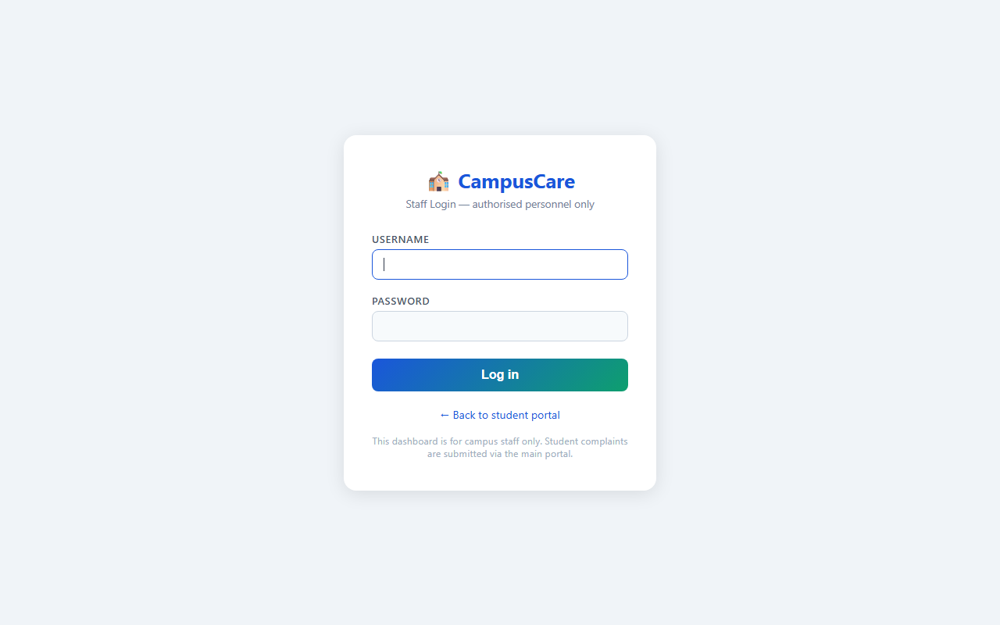

# CAMPUSCARE — Staff Complaint Dashboard

This document describes the dedicated staff complaint dashboard implemented in branch `feature/staff-dashboard` (Issue #1).

---

## 1. Overview & Route

- **Dashboard Route:** `/dashboard/`
- **Status Update Route:** `/dashboard/update/<int:complaint_id>/`
- **Authentication Route:** `/accounts/login/`

The dashboard allows authorized campus staff to review, search, filter, and triage student complaints directly without having to use the raw Django administration interface (`/admin/`).

---

## 2. Access Control & Security

- **Staff-only Protection:** Access to `/dashboard/` is guarded by `@login_required(login_url='login')` and custom `@staff_required` (`user.is_active and user.is_staff`).
- **Redirection:** Unauthenticated requests and non-staff student users are redirected to `/accounts/login/`.
- **Status Update Protection:** Status updates are strictly restricted to HTTP POST requests by authenticated staff members, validating status against permissible choices (`Open`, `In Progress`, `Resolved`).
- **CSRF Protection:** All forms include Django's ``.

---

## 3. Features

### 3.1 Summary Metrics Cards
Real-time summary counters calculated across stored complaints:
- **Total Complaints**
- **Open Complaints**
- **In Progress Complaints**
- **Resolved Complaints**
- **High Priority Complaints**
- **Duplicate Complaints**

### 3.2 Search & Multi-Attribute Filtering
- **Keyword Search:** Instant case-insensitive matching across complaint descriptions.
- **Category Filter:** Filter by *Academic*, *Hostel*, *Infrastructure*, *IT & Wi-Fi*, or *Transport*.
- **Priority Filter:** Filter by *High*, *Medium*, or *Low*.
- **Status Filter:** Filter by *Open*, *In Progress*, or *Resolved*.
- **Department Filter:** Filter by assigned department (*Academic Office*, *Hostel Management*, *IT Department*, *Maintenance*, *Transport Office*, *Administration*).
- **Clear Filters:** Single-click reset back to full view.

### 3.3 Visual Triage Highlights
- **High Priority Rows:** Highlighted in soft red with bold red alert badges to draw immediate attention to critical campus issues.
- **Duplicate Complaints:** Highlighted with warning badges (`⚠ Duplicate`) to prevent duplicate work across staff members.

### 3.4 In-Place Status Management
- Staff can update complaint status directly in the table using an inline dropdown and **Save** button.
- Updates persist directly to the database and reload the dashboard view.

---

## 4. Screenshots

### Staff Dashboard Overview


### Filtered View (High Priority Complaints)


### Staff Login Page


---

## 5. Automated Tests

The dashboard is backed by a comprehensive suite of **52 automated tests** in `complaints/tests.py`:

```bash
# Run complaints test suite
python manage.py test complaints
```

### Coverage Breakdown:
- **`ComplaintModelTest`** (5 tests): Model field persistence, default values, `__str__`, status mutation.
- **`HomeViewTest`** (5 tests): Verifies that student complaint submission flow is preserved and untouched.
- **`DashboardAccessControlTest`** (4 tests): Verifies redirection for unauthenticated & non-staff users, staff access, and login page availability.
- **`DashboardSummaryTest`** (7 tests): Validates total, open, in progress, resolved, high priority, and duplicate counts.
- **`DashboardFilterTest`** (11 tests): Validates single & multi-parameter filtering, case-insensitive text search, and empty state handling.
- **`StatusUpdateTest`** (7 tests): Validates state transitions, invalid status rejection, 404 on missing records, and unauthorized attempt rejection.
- **`DashboardContextTest`** (5 tests): Ensures context data consistency and newest-first record sorting.
- **`MLPredictionTest`** (8 tests): Ensures baseline category, priority, and duplicate ML predictions function correctly.
