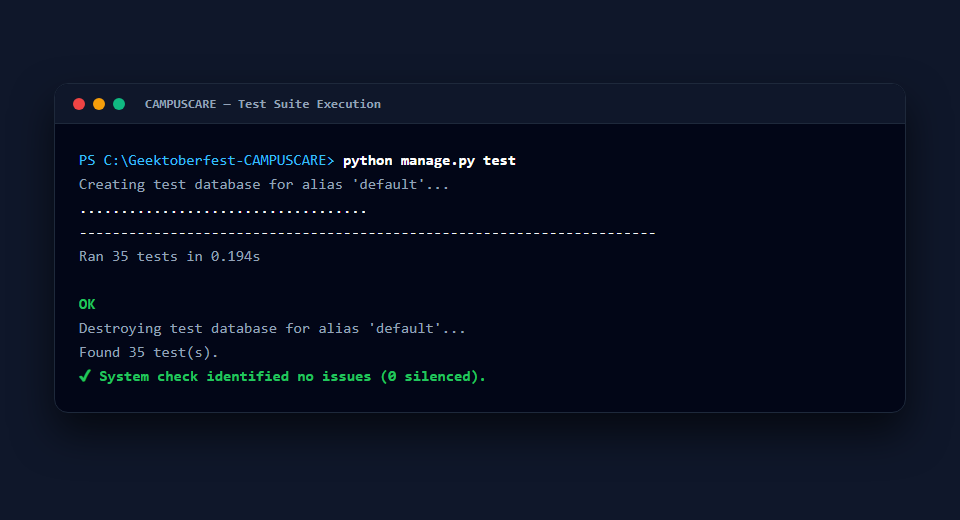
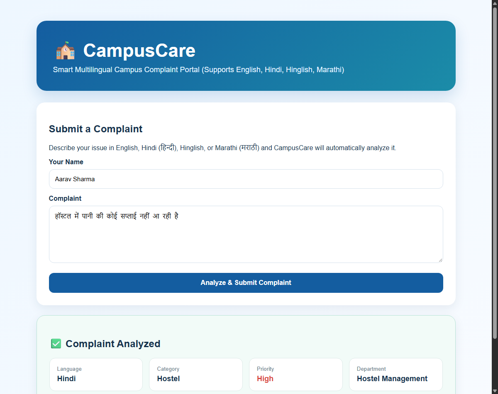
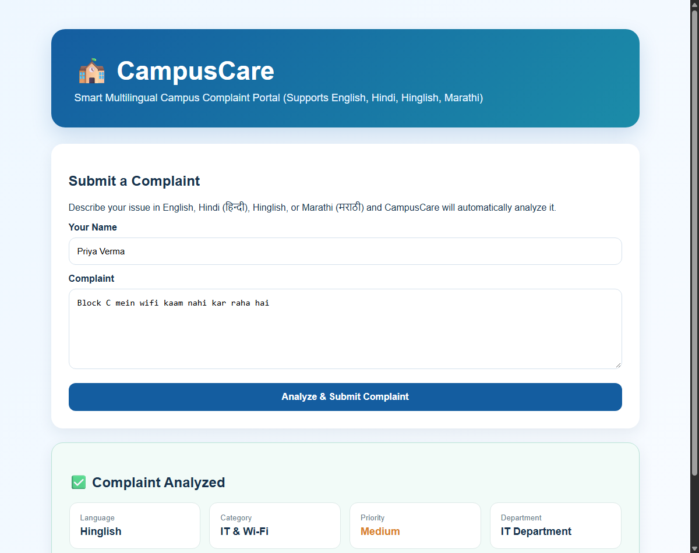

# Multilingual Complaint Support in CAMPUSCARE

This document details the architectural approach, implementation details, evaluation results, and known limitations of the multilingual complaint triage system in CAMPUSCARE, addressing [Issue #3](https://github.com/Geektoberfest/Geektoberfest-CAMPUSCARE/issues/3).

---

## 1. Architectural Approach & Evaluation

When designing multilingual support for CAMPUSCARE, three principal paradigms were evaluated:

| Approach | Latency | Infrastructure Cost / Footprint | Offline / CI Reliability | Verdict |
| :--- | :--- | :--- | :--- | :--- |
| **Neural Transformer Embeddings** (e.g. XLM-RoBERTa, Multilingual MiniLM) | High (200–800 ms CPU) | Heavy (>1.5 GB PyTorch + model weights; exceeds Render 512 MB free tier RAM) | Moderate (slow build times, heavy downloads) | **Rejected** |
| **External Translation API** (e.g. Google Cloud, DeepL) | High (300–1500 ms HTTP) | Requires external API keys, billing setup, and network availability | Poor (fails in offline CI environments, rate-limiting risks) | **Rejected** |
| **Native Multilingual TF-IDF + Logistic Regression with Script-Aware Preprocessing** | **Sub-millisecond (< 5 ms)** | **Zero additional dependencies** (uses existing Scikit-learn, Pandas, NumPy) | **100% offline, deterministic, instant CI test runs** | **Selected** |

### Why Native Multilingual Classification Was Chosen
1. **Lightweight & Cloud-Ready**: Maintains a minimal deployment footprint suitable for constrained environments (such as Render free tiers) without requiring gigabytes of deep learning dependencies.
2. **Deterministic & Fast**: Sub-millisecond inference ensures real-time feedback for students submitting complaints.
3. **Zero External API Dependencies**: Works completely offline, ensuring hermetic test suite execution and high reliability.

---

## 2. Supported Languages

CAMPUSCARE supports **four** language profiles end-to-end:

1. **English (`English`)**: Standard campus complaints in English.
2. **Hindi (`Hindi`)**: Complaints written in Devanagari script (e.g., `हॉस्टल में पानी नहीं आ रहा है`).
3. **Hinglish (`Hinglish`)**: Romanized Hindi commonly used by students in chats and messages (e.g., `Hostel mein paani nahi aa raha hai`).
4. **Marathi (`Marathi`)**: Complaints written in Devanagari script with Marathi vocabulary (e.g., `वसतिगृहात पाण्याचा पुरवठा बंद आहे`).

---

## 3. Pipeline Implementation

```text
Incoming Student Complaint
           ↓
Unicode Normalization (NFC)
           ↓
Language Detection (English / Hindi / Hinglish / Marathi)
           ↓
Script-Aware Tokenization (r"[\u0900-\u097Fa-zA-Z0-9_]+")
           ↓
TF-IDF Vectorization (Unigrams & Bigrams)
           ↓
Logistic Regression Category Prediction
           ↓
Multilingual Priority Detection (High / Medium / Low)
           ↓
Department Routing & Duplicate Similarity Check
           ↓
Persistence to SQLite / PostgreSQL & Web UI Display
```

### A. Unicode Normalization & Script-Aware Tokenization
Standard regular expressions like `\b\w+\b` fail on Devanagari characters because combining vowel signs (*matras*, e.g., `ॉ`, `ू`, `ी`) and viramas are treated as word boundaries or stripped, corrupting words such as `हॉस्टल` into fragmented syllables.

We introduced:
- **Unicode NFC Normalization** via Python's standard `unicodedata` library.
- **Custom Token Pattern**: `r"[\u0900-\u097Fa-zA-Z0-9_]+"`. This treats entire Devanagari words and Latin terms as cohesive tokens while retaining both unigram and bigram context (`ngram_range=(1, 2)`).

### B. Language Detection (`detect_language`)
1. **Devanagari Check**: If Unicode codepoints in the range `\u0900-\u097F` are detected, the text is evaluated against characteristic Marathi lexical markers (e.g., `नाही`, `आहे`, `मध्ये`, `येत`, `वसतिगृह`, `दुरुस्ती`, `बाक`, `वेळापत्रक`, `महाविद्यालय`). If present, it resolves to `Marathi`; otherwise, it resolves to `Hindi`.
2. **Latin Check**: If written in Latin script, the tokens are checked against high-frequency Hinglish transliteration terms (e.g., `mein`, `nahi`, `kaam`, `paani`, `dikkat`, `toota`, `kharab`, `chal`). If detected, it resolves to `Hinglish`; otherwise, it defaults to `English`.

### C. Multilingual Priority Rules (`predict_priority`)
The priority detection rules were extended with comprehensive lexicons across all four languages:
- **High Priority**:
  - English: `emergency`, `urgent`, `danger`, `fire`, `accident`, `unsafe`, `medical`, `power outage`, `no water`
  - Hindi: `आपातकालीन`, `तुरंत`, `खतरा`, `आग`, `दुर्घटना`, `असुरक्षित`, `मेडिकल`, `सुरक्षा`, `तत्काल`, `बिजली गुल`, `पानी नहीं`
  - Hinglish: `khatra`, `aag`, `asurakshit`, `turant`, `jaldi`, `tatkaal`, `bijli gul`, `paani nahi`, `power cut`, `light nahi`
  - Marathi: `आणीबाणी`, `तातडीने`, `धोका`, `अपघात`, `वैद्यकीय`, `लगेच`, `वीज गेली`, `पाणी बंद`
- **Medium Priority**:
  - English: `not working`, `broken`, `slow`, `problem`, `issue`, `damaged`, `missing`
  - Hindi: `काम नहीं कर रहा`, `खराब`, `टूटा`, `टूटी`, `धीमा`, `समस्या`, `दिक्कत`, `गायब`
  - Hinglish: `kaam nahi kar raha`, `work nahi kar raha`, `kharab`, `dikkat`, `toota`, `tooti`, `chal nahi raha`
  - Marathi: `चालत नाही`, `काम करत नाही`, `नादुरुस्त`, `बंद पडले`, `तुटलेले`, `तुटला`, `हळू`, `अडचण`
- **Low Priority**: Default when no urgency or defect indicators are matched.

### D. Duplicate Detection (`detect_duplicate`)
Duplicate checking uses TF-IDF cosine similarity ($\ge 0.75$) with the script-aware token pattern, accurately flagging duplicate complaints submitted in Hindi, Marathi, Hinglish, or English.

---

## 4. Dataset & Evaluation Results

- **Synthetic Multilingual Dataset**: Generated using `data/generate_dataset.py`, containing **1,000 complaints** balanced evenly across the 5 categories (200 per category) and 4 languages (50 per language per category).
- **Validation**:
  - **5-Fold Stratified Cross-Validation**: **99.9% mean classification accuracy**.
  - **Unit & Integration Tests**: 35 automated test cases in `complaints/tests.py` covering category prediction, priority detection, duplicate detection, language detection, and end-to-end view submission.

---

## 5. Documented Limitations

1. **Mixed-Script / Heavy Code-Switching**: Sentences mixing multiple scripts simultaneously (e.g. Devanagari combined with non-Hindi/non-Marathi regional scripts) may default to the script with dominant characters.
2. **Out-of-Vocabulary Slang**: Highly informal campus slang or novel abbreviations not present in campus complaint patterns may have lower confidence.
3. **Cross-Language Duplicate Detection**: Duplicate similarity is lexical (TF-IDF cosine similarity); therefore, an English complaint will not match a Devanagari complaint about the same physical event unless transliterated terms overlap.
4. **Tested Languages Scope**: Support is strictly limited and tested for **English, Hindi, Hinglish, and Marathi**. Other Indic or foreign languages are not officially supported.

---

## 6. Visual Proof & Verification

### Test Suite Execution


### Hindi Complaint Triage


### Hinglish Complaint Triage


### Marathi Complaint Triage


